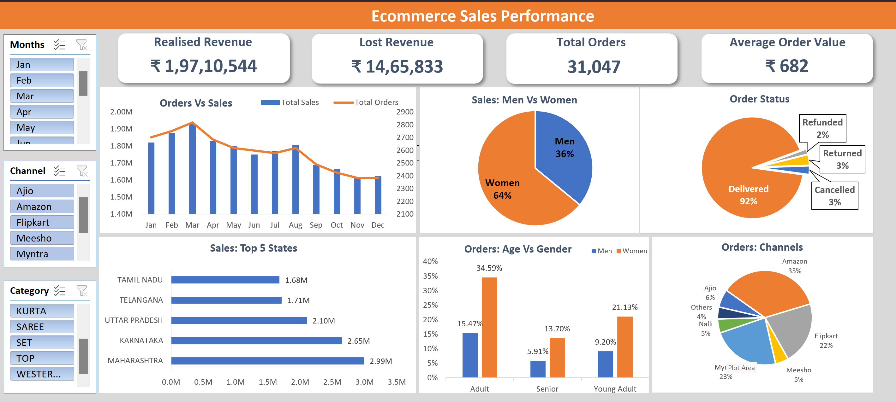

# E-Commerce Apparel Sales & Revenue Leakage Analysis (Excel)


## 1. Project Overview & Business Objective
An end-to-end exploratory data analysis and interactive KPI dashboard built in **Microsoft Excel** analyzing **31,047 retail apparel transactions** from 2022 (Vrinda Store dataset). 

While standard retail reports track only gross sales, this project separates **Realised Revenue** from **Lost Revenue (cancellations, returns, and refunds)**, segments customers by corrected age-gender cohorts, and identifies channel and regional performance drivers to support targeted marketing and operational improvements.

---

## 2. Dashboard Preview
> *Interactive dashboard featuring 4 dynamic KPI cards, 6 Pivot Charts, and 3 cross-connected slicers (Months, Channel, Category).*



### Headline KPIs (Full Year 2022)
| Metric | Value | Business Context |
| :--- | :--- | :--- |
| **Total Orders** | **31,047** | Total transactions processed across 7 sales channels |
| **Realised Revenue** | **₹ 1,97,10,544** | Net revenue from **Delivered** orders (92.25% fulfillment) |
| **Lost Revenue** | **₹ 14,65,833** | Revenue leakage from Cancelled, Returned, and Refunded orders (7.75%) |
| **Average Order Value (AOV)** | **₹ 682** | Gross average revenue per order across all categories |

---

## 3. Business Questions Addressed
1. How do monthly **Sales and Order Volumes** trend together across 2022, and which month peaked?
2. How much revenue is **actually realized vs. lost** due to cancellations, returns, and refunds?
3. What is the purchasing split between **Men and Women**?
4. Which **Age Group × Gender** cohorts drive the highest order volume?
5. Which **Top 5 States** contribute the largest share of sales?
6. Which **Sales Channels** dominate order volume, and where is order leakage highest?
7. Which **Product Categories** drive revenue vs. Average Order Value (AOV)?

---

## 4. Data Cleaning & Preparation Pipeline
Raw transactional data (`31,047 rows × 19 columns`) underwent a structured cleaning workflow before analysis:

* **Standardized Gender Labels:** Consolidated inconsistent entries (`M`, `W`, `Men`, `Women`) into uniform `Men` and `Women` values using Find & Replace.
* **Standardized Product Categories:** Fixed mixed-case inconsistencies (e.g., lowercase `kurta` vs. `Set`) to uniform uppercase (`KURTA`, `SET`, `SAREE`, `TOP`, `WESTERN DRESS`) so Pivot Tables and slicers aggregate cleanly.
* **Corrected Quantity Formatting:** Replaced text-based numbers (`One`, `Two`) with numeric integers (`1`, `2`) to enable accurate math aggregations.
* **Trimmed Column Headers:** Removed trailing whitespace (e.g., `Channel `) to prevent formula and Pivot reference issues.
* **Feature Engineering (Helper Columns):**
  * **Age Group Cohorts:** Corrected overlapping age labels to create realistic business buckets using nested `IF`:
    ```excel
    =IF(E2>=50, "Senior", IF(E2>=30, "Adult", "Young Adult"))
    ```
  * **Month Extraction:** Extracted chronological month abbreviations from transaction dates using `=TEXT(G2, "mmm")`.
* **Gross vs. Net Revenue Separation:** Built a dedicated `Orders KPI` calculation layer using `SUMIF` to isolate Delivered revenue (`Realised Revenue`) from Cancelled/Returned/Refunded orders (`Lost Revenue`), ensuring KPI cards update dynamically with slicers without `GETPIVOTDATA` errors.

---

## 5. Key Insights
* **Strong Q1 Momentum, H2 Slowdown:** **March** recorded the highest sales (**~₹1.93M**) and order volume (**~2,819 orders**), followed by February and January. Sales steadily declined in H2 (September–December), bottoming out around ₹1.61M–₹1.62M in November–December.
* **Women Dominate Purchasing:** **Women account for 64%** of total sales compared to **36% for Men**.
* **Core Demographic Sweet Spot:** **Adult Women (ages 30–49)** are the single largest customer segment at **34.59%** of all orders, followed by **Young Adult Women (<30)** at **21.13%**. Overall, Adults (30–49) drive **~50%** of total volume.
* **High Regional Concentration:** The **Top 3 states—Maharashtra (₹2.99M), Karnataka (₹2.65M), and Uttar Pradesh (₹2.10M)**—generate **~35%** of total revenue, followed by Telangana (₹1.71M) and Tamil Nadu (₹1.68M).
* **Marketplace Dependency:** **Amazon (35%)**, **Myntra (23%)**, and **Flipkart (22%)** drive **80% of all orders**, while Ajio (6%), Meesho (5%), Nalli (5%), and Others (4%) make up the remaining 20%.
* **Revenue Leakage & Fulfillment Health:** While **92%** of orders are successfully delivered, **8% (~₹14.66 Lakh)** is lost across Cancelled (3%), Returned (3%), and Refunded (2%) orders—with higher loss rates observed on Amazon and Flipkart compared to Ajio.

---

## 6. Actionable Business Recommendations
1. **Target High-ROI Customer Segments:** Prioritize ad spend, seasonal coupons, and loyalty campaigns toward **Women aged 30–49** in **Maharashtra, Karnataka, and Uttar Pradesh** across **Amazon, Myntra, and Flipkart**.
2. **Recover ₹14.66 Lakh in Revenue Leakage:** Audit product sizing charts, fabric descriptions, and packaging quality on **Amazon and Flipkart** to reduce the 8% cancellation/return rate. Even a 25% reduction in order leakage recovers **~₹3.6 Lakh** in net revenue.
3. **Counter the H2 Sales Dip (Sep–Dec):** Launch festive-season bundles (Diwali/Navratri/Winter collections) starting in September to arrest the second-half revenue slide.
4. **Lift Average Order Value (₹682) via Category Bundling:** Cross-sell complementary items (e.g., bundling `KURTA` orders with bottoms/dupattas to mirror high-AOV `SET` purchases).

---

## 7. Repository Structure
```text
ecommerce-sales-performance-excel/
├── README.md                             # Project summary, insights & recommendations
├── assets/
│   └── dashboard_preview.png             # High-resolution screenshot of the final dashboard
├── data/
│   └── Vrinda_Store_Data_Analysis.xlsx   # Cleaned dataset, Pivot Tables, KPI logic & Dashboard
└── docs/
    └── DATA_CLEANING_AND_INSIGHTS.md     # Detailed data dictionary, formulas & Q&A breakdown
```

---

## 8. How to Use This Workbook
1. Download `data/Vrinda_Store_Data_Analysis.xlsx` and open it in **Microsoft Excel** (Excel 2016 or later recommended).
2. Navigate to the **`Vrinda Store Report 2022`** sheet.
3. Use the **Months**, **Channel**, and **Category** slicers on the left panel to filter all 4 KPI cards and 6 visual charts simultaneously.
4. Click the **Clear Filter** icon (top-right of each slicer) to reset to full-year 2022 metrics.